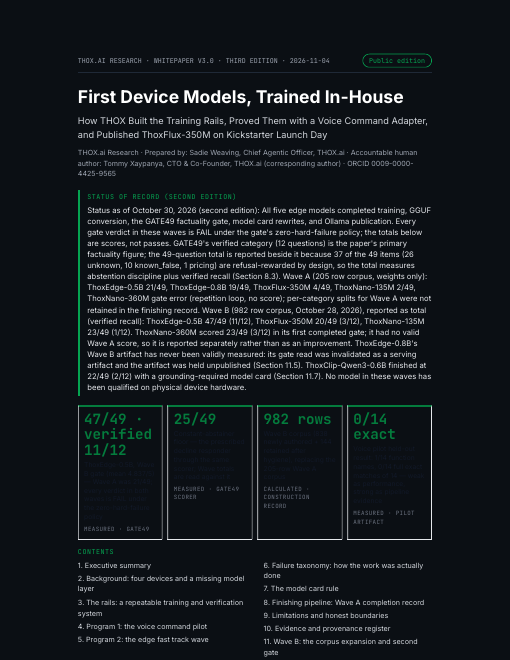

# First Device Models, Trained In-House

[](LICENSE)
[](https://github.com/ttracx/thox-first-device-models-paper/commits/main)
[](https://github.com/ttracx/thox-first-device-models-paper/releases)
[](https://thox.ai/research)
[](https://doi.org/10.5281/zenodo.23969824)

**THOX.ai Research whitepaper, Third Edition (v3.0) (public edition), 4 November 2026.**
A Process v1.0 reissue of the Second Edition (hardened paper-version 2.1, 30 October 2026), content unchanged except the changes recorded in the paper's Document control.
Prepared by: Sadie Weaving, Chief Agentic Officer, THOX.ai. Accountable human author: Tommy Xaypanya, Chief Technology Officer & Co-Founder, THOX.ai (corresponding author). ORCID: [0009-0000-4425-9565](https://orcid.org/0009-0000-4425-9565).
Preprint, not peer reviewed. License: CC BY 4.0. Authorship follows the paper's front matter, unchanged from the second edition, including its authorship disclosure.



## About the paper

On October 27, 2026 — Kickstarter launch day — THOX built its in-house training rails and produced its first device models with them: a voice-command LoRA pilot on LFM3-1.7B (held-out: 1/14 function names, 0/14 full exact matches — pipeline evidence, not a production adapter) and a five-model edge wave gated by the 49-question GATE49 factuality gate. Every gate verdict in Waves A and B is FAIL under the gate's zero-hard-failure policy; the paper reports verified recall (of 12) as the primary figure beside each total. Wave B (982-row corpus) took ThoxEdge-0.5B from 21/49 to 47/49 (verified 11/12) against a constant-abstainer floor of 25/49; ThoxEdge-0.8B's Wave B artifact was never validly measured and was held. An eleven-class failure taxonomy, a model-card rule, and a full provenance register accompany the results.

This Third Edition reissues the second edition in the THOX Research Paper Template v1.0: the source was reconstructed from the second edition's DOCX (the only editable source that survives) with table-level fidelity verification, the evidence was consolidated into one source (`exp/results/summary.json`), a GATE49 wave explorer demo was added, and internal host identifiers were genericized under the Process §4 security sweep. No measured result was altered.

## DOI and canonical copies

- **DOI: [10.5281/zenodo.23969824](https://doi.org/10.5281/zenodo.23969824)** (concept DOI, all versions: [10.5281/zenodo.23969823](https://doi.org/10.5281/zenodo.23969823))
- Zenodo record: https://zenodo.org/records/23969824
- Paper page: https://thox.ai/research/papers/first-device-models
- Hugging Face: folder `first-device-models/` in the [Thox-ai/thox-whitepapers](https://huggingface.co/datasets/Thox-ai/thox-whitepapers) dataset (the first- and second-edition files remain at the dataset root)
- This repository: paper PDF + HTML edition + interactive demo in `paper/`, the full artifact bundle in `artifact/`

| File | SHA-256 |
|---|---|
| `paper/THOX_First_Device_Models_Trained_In-House_Whitepaper_v3.0.pdf` (375,292 bytes) | `e27d90bfffb5b51fe19c4a76a3105aa67ae47f3767ef336796acfeffd089a4d7` |
| `paper/THOX_First_Device_Models_Trained_In-House_Whitepaper_v3.0.html` (720,579 bytes) | `ed9c6ade385b4eeddeaa493118980edad51d624c6691afa1e11ccd0bcbba500c` |
| `paper/FirstDeviceModels_Demo_v3.0.html` (21,126 bytes) | `72a922da185c54c9ab45248c4270776ab8476e6da97b5b14f8f53d428e05782e` |
| Release asset `THOX_First_Device_Models_Trained_In-House_Whitepaper_v3.0_artifact.zip` (4,167,260 bytes) | `98b95c09c8cb644ced79babd5bc3bba61fa3b05de1be9a9f63b8924cd9e3e643` |

## Headline results

- **ThoxEdge-0.5B: 21/49 in Wave A → 47/49 in Wave B** (verified recall 11/12), on the 982-row Wave B corpus that replaced the 205-row Wave A corpus.
- **Every GATE49 verdict in Waves A and B is FAIL** under the gate's zero-hard-failure policy; the totals are scores, not passes, and the paper reads them against the **constant-abstainer floor of 25/49**.
- **Voice-command pilot (LFM3-1.7B LoRA):** held-out 1/14 function names, 0/14 full exact matches — weak as performance, strong as pipeline evidence.
- **ThoxEdge-0.8B's Wave B artifact was never validly measured and was held**; the paper states this rather than reconstructing a result.
- **Eleven-class failure taxonomy** (§6.2) and a full provenance register (§10) accompany the results; the Research Loop audit's taxonomy item (AB-1) was re-verified line-by-line for this edition and holds.
- For this edition: reconstruction fidelity **27/27 tables, 754/754 cells, 400/400 paragraphs**, and every headline figure re-checked — **86/86 PASS** (`artifact/wp/qa/`).

## Quick start

```bash
git clone https://github.com/ttracx/thox-first-device-models-paper.git
cd thox-first-device-models-paper
# Read the paper:
open paper/THOX_First_Device_Models_Trained_In-House_Whitepaper_v3.0.pdf        # macOS
xdg-open paper/THOX_First_Device_Models_Trained_In-House_Whitepaper_v3.0.pdf    # Linux
# Run the interactive GATE49 wave explorer demo (single file, no network needed):
open paper/FirstDeviceModels_Demo_v3.0.html
# Inspect the evidence behind every printed number:
ls artifact/exp/results/
```

## Repository layout

| Path | Contents |
|---|---|
| `paper/` | The shipped edition: paper PDF, single-file HTML edition, and the GATE49 wave explorer demo (canonical bytes, hashes above). |
| `artifact/` | The artifact bundle: `src/` (the second-edition DOCX/PDF of record and the reconstructed Markdown source), `exp/` (`exp/results/summary.json` — the single evidence source — with the waves A/B supplement and the staged run records), `wp/` (the Template v1.0 build and the QA record), `dist/`, the pack README, citation set, and `MANIFEST.sha256.json`. |
| `docs/` | `USER_GUIDE.md`, `QUICKSTART.md`, `DEVELOPMENT.md`, `previews/` (rendered cover). |
| `.agents/HANDOFF.md` | Agent handoff: status, key files, conventions, open items. |
| `CITATION.cff`, `paper.bib`, `citation.bib` | Citation set. `paper.bib` is the canonical BibTeX file name (matching the THOX paper-repo template); `citation.bib` is an identical copy. |
| `LICENSE`, `NOTICE.md` | CC BY 4.0 license text and IP attribution. |

The models themselves are not in this repository. The Waves A/B models live in their own model repositories under the Thox-ai Hugging Face organization and on Ollama; this repo is the paper and its evidence record.

## Documentation map

- User guide: [docs/USER_GUIDE.md](docs/USER_GUIDE.md)
- Quick start: [docs/QUICKSTART.md](docs/QUICKSTART.md)
- Development: [docs/DEVELOPMENT.md](docs/DEVELOPMENT.md)
- Agent handoff: [.agents/HANDOFF.md](.agents/HANDOFF.md)

## Releases

Formal releases live on the [Releases page](https://github.com/ttracx/thox-first-device-models-paper/releases). Release `v3.0` carries the paper PDF, the HTML edition, the demo, and the artifact ZIP as assets, byte-identical to `paper/` and the pack of record.

## License, IP, and governance

The paper, demo, documentation, and evidence results in this repository are © 2026 THOX.ai LLC and are licensed under CC BY 4.0 (see `LICENSE` and `NOTICE.md`). THOX and Your AI. Your Data. Your Rules. are trademarks of THOX.ai LLC; third-party names are used for identification only. This repository is the publication record for the paper: changes follow the THOX Research Paper Process v1.0 — a new edition is a new version here and a new version on Zenodo, never a silent edit.

## Agent handoff

Agents resuming work on this repository start at [.agents/HANDOFF.md](.agents/HANDOFF.md).
